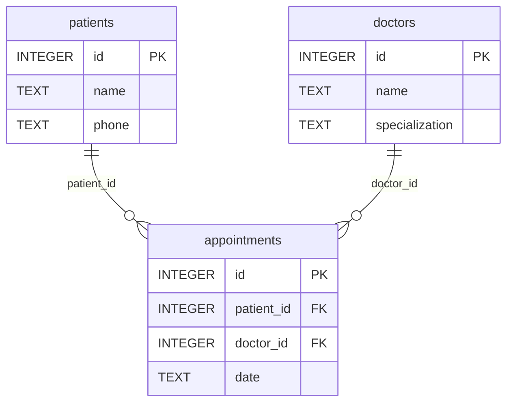

# Специфікація

## Мета і межі

Мінімальний облік пацієнтів приватного медичного кабінету.
JavaScript, Express, SQLite через better-sqlite3.
Поточна версія створює пацієнтів, лікарів і прийоми та повертає їхні списки.
Прийом має тільки дату; графік, час, авторизація та оплати не реалізуються.

## Компоненти та взаємодія

| Компонент  | Файл                                  | Відповідальність                        |
| ---------- | ------------------------------------- | --------------------------------------- |
| Запуск     | src/server.js                         | Порт 3000 і запуск HTTP                 |
| Застосунок | src/app.js                            | JSON, маршрути, помилки, health/version |
| Routes     | src/routes/clinic.routes.js           | Адреси шести операцій                   |
| Controller | src/controllers/clinic.controller.js  | HTTP-запит і відповідь                  |
| Service    | src/services/clinic.service.js        | Перевірка введення                      |
| Repository | src/repositories/clinic.repository.js | SQL із параметрами                      |
| Database   | src/config/database.js                | Відкриття файла та створення таблиць    |

Шлях запиту: routes → controller → service → repository → database.
Нижній шар не імпортує верхній. Один clinic об'єднує мінімальні пов'язані операції.

## Дані та зв'язки

Рівно три таблиці. id — первинний ключ.
Обидва зовнішні ключі прийому обов'язкові; foreign_keys увімкнено.
name, phone та specialization — непорожні рядки після trim().
patientId і doctorId — додатні безпечні цілі числа.
date — справжня календарна дата YYYY-MM-DD.

## Ключові сценарії

| Ініціатор і дія                 | Читання / зміна                               | Результат                                      |
| ------------------------------- | --------------------------------------------- | ---------------------------------------------- |
| Користувач додає пацієнта       | Перевірка полів, INSERT patients              | 201 і створений запис                          |
| Користувач додає лікаря         | Перевірка полів, INSERT doctors               | 201 і створений запис                          |
| Користувач створює прийом       | Перевірка id/дати, INSERT appointments        | 201; FK гарантують існування зв'язаних записів |
| Користувач відкриває список     | SELECT відповідної таблиці                    | 200 і масив                                    |
| Неправильні дані / відсутній FK | INSERT не виконується або відхиляється SQLite | 400; новий запис не створюється                |

База data/clinic.db зберігається після зупинки процесу.
Для тестів використовується окрема БД :memory:.
Приймання: npm run check, рівно три таблиці та перевірка збереження після перезапуску.
